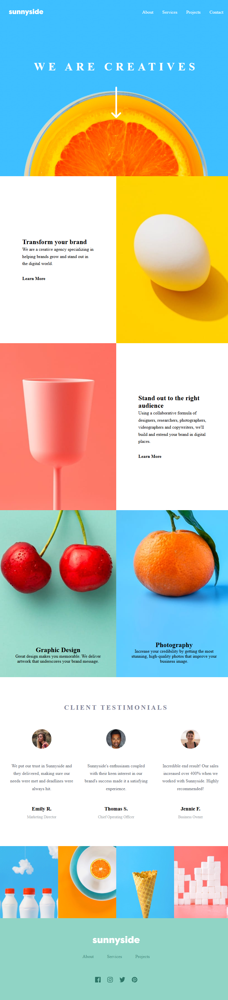

Sunnyside Agency Landing Page

A modern, responsive landing page for a creative agency, built with HTML, CSS, and JavaScript.

About the Project

This project is a creative agency landing page designed to showcase services, highlight customer testimonials, and present completed projects through an engaging and visually appealing interface.

Technologies Used

- HTML5
- CSS3
- CSS Grid
- Flexbox
- JavaScript

Features

- Responsive desktop and mobile layouts
- Mobile-friendly navigation menu
- Interactive hamburger menu
- Services and feature sections
- Customer testimonials
- Project image gallery
- Social media links

What I Learned

- Building structured web pages with semantic HTML
- Creating responsive layouts using CSS Grid and Flexbox
- Implementing media queries
- Working with images and background images
- Adding interactivity with JavaScript

Live Demo

"View Live Website" (https://ifeco200.github.io/sunnyside-landing-page/)

Author

Created by ifeco200 as part of my frontend development journey.

Acknowledgements

Design inspiration and project challenge from "Frontend Mentor" (https://www.frontendmentor.io/).

## Website Preview

